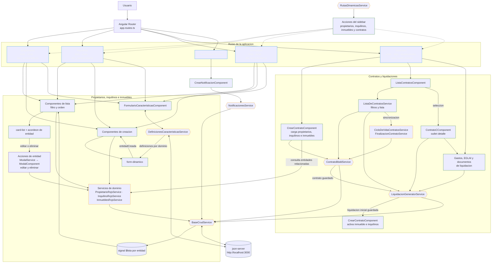

# Flujo general de la aplicacion

Este diagrama resume como se conectan las rutas, las pantallas, los servicios y la API. Es un mapa de arquitectura: los recorridos de cada entidad y el ciclo del contrato se detallan en sus diagramas especificos.

## Alcance y notas

- El flujo general da una vista de conjunto; no reemplaza los diagramas de [propietarios](./propietarios_flujo.md), [inquilinos](./inquilinos_flujo.md) e [inmuebles](./inmuebles_flujo.md), que muestran sus diferencias de captura y relacion entre datos.
- `RutasDinamicasService` prepara las acciones del sidebar; la definicion de pantallas y URLs esta en `app.routes.ts`.
- Las entidades principales comparten `BaseCrudService`, que centraliza las peticiones CRUD y mantiene el signal `$lista`. Las definiciones de caracteristicas se guardan por dominio en `/definiciones`.
- La ruta `/notificaciones/crear` existe, pero el formulario actual es una funcionalidad de prueba y aun no esta integrada como flujo completo del sidebar.
- La creacion de contratos usa propietarios, inquilinos e inmuebles; al guardarse, crea una liquidacion inicial e intenta activar el inmueble y los inquilinos asociados.
