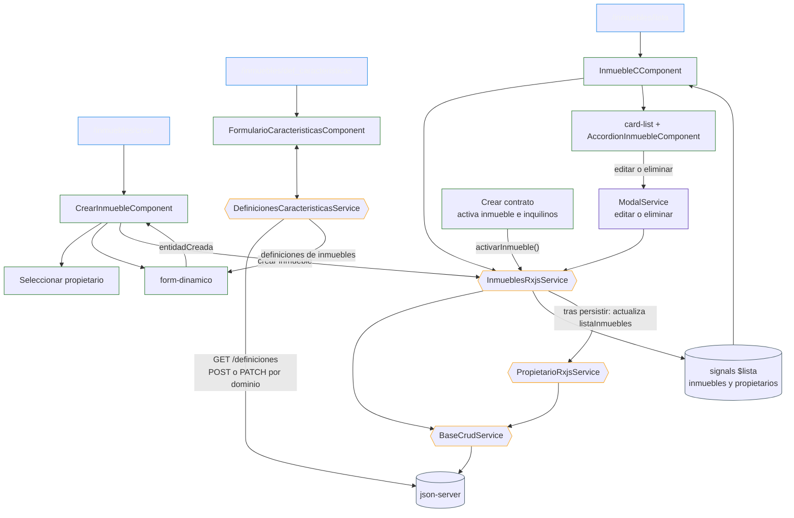

# Flujo del dominio Inmuebles

El alta requiere elegir un propietario. Se guarda el inmueble y luego se agrega su ID a `listaInmuebles` del propietario. La activacion del inmueble ocurre al crear un contrato.
